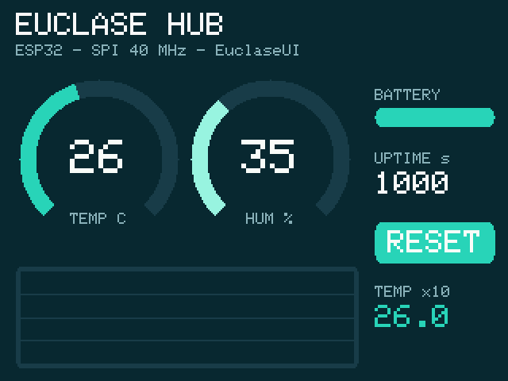

# QuasarUI

Dependency-free C++ UI toolkit for SPI TFT displays (ESP32 / Arduino): RGB565 framebuffer, dirty-rectangle flushing, and a small set of widgets.

[](https://github.com/SemyonZamiakin/QuasarUI/actions/workflows/ci.yml)




*Output of the bundled host simulator running the library code against a virtual ILI9341 (2x upscaled). These are not photographs of hardware; see [Status](#status).*

## Overview

A full 320x240 frame over 40 MHz SPI takes about 31 ms. A typical dashboard changes one gauge, one label and one chart per tick, not the whole screen.

QuasarUI keeps an RGB565 framebuffer in RAM, tracks which rectangle each widget touched, and transmits only those rectangles to the panel.

| Scenario (320x240, 40 MHz SPI, simulated) | Pixels sent | SPI time |
|---|---:|---:|
| Full redraw | 76 800 | 30.7 ms |
| Demo dashboard, every widget changing on every frame | ~29 000 (38 %) | ~11.6 ms |
| Idle frame (nothing changed) | 0 | 0 ms |
| One label update | at most the label rectangle | well under 1 ms |

The numbers are produced by `test/render_gallery.cpp`. Real throughput depends on the MCU and its SPI driver.

## Design

- **Transport abstraction (`qs::Bus`).** The core does not include Arduino or ESP-IDF headers. Any SPI layer can be plugged in by implementing five methods: `begin`, `reset`, `command`, `data`, `delayMs`.
- **Panel drivers.** ST7789 (240x240, 240x320) and ILI9341 (240x320), four rotations, RAM-offset handling for 240x240 modules.
- **Canvas.** Clipped primitives (rectangle, line, circle, rounded rectangle, arc), a scalable built-in 5x7 font, dirty-rectangle tracking.
- **Widgets.** `Label`, `ProgressBar`, `Gauge` (270 degree dial), `Graph` (ring buffer, automatic or fixed range), `Button`.
- **`Screen`.** Redraws only invalid widgets and flushes once per widget, so distant updates are never merged into one large rectangle.
- **Memory.** No heap allocation inside the library. The caller owns the framebuffer and graph storage.
- **Testability.** A virtual panel decodes `CASET` / `RASET` / `RAMWR`, so unit tests assert what would reach the glass.

## Quick start (Arduino-ESP32)

```cpp
#include <QuasarUI.h>
using namespace qs;

ArduinoSpiBus bus(SPI, /*cs*/5, /*dc*/2, /*rst*/4, 40000000UL);
Panel  panel(bus, PanelConfig::ILI9341_240x320());
Label  title({10, 8, 220, 16}, 2);
Gauge  temp(62, 100, 50, "TEMP C", colors::Orange);
Canvas* canvas; Screen* screen;

void setup() {
    canvas = new Canvas((Color*)malloc(Canvas::bytesFor(320, 240)), 320, 240);
    panel.begin();  panel.setRotation(1);
    screen = new Screen(*canvas, panel);
    screen->add(&title); screen->add(&temp);
    title.setText("QUASAR HUB");  temp.setRange(0, 60);
}
void loop() {
    temp.setValue(readTemperature());
    screen->update();          // transmits nothing if nothing changed
    delay(100);
}
```

Complete sketch: [`examples/Dashboard`](examples/Dashboard/Dashboard.ino). Install by copying the folder into the Arduino `libraries/` directory, or through PlatformIO (`library.json`).

Wiring used by the example (ESP32 VSPI): SCK 18, MOSI 23, CS 5, DC 2, RST 4, LED to 3V3.

### Memory

| Display | Framebuffer |
|---|---:|
| 240x240 | 112.5 KB |
| 320x240 | 150 KB |

Allocate the framebuffer with `malloc`, not as a static array: static DRAM on the ESP32 is limited. AVR boards (Uno, Nano) do not have enough RAM for a full framebuffer and are not supported.

### Porting

Implement the five `qs::Bus` methods for your platform. `ArduinoSpiBus` is about 50 lines and can serve as a template for ESP-IDF `spi_master`, the Pico SDK or Linux spidev.

## Build and test on a PC

```bash
cmake -S . -B build && cmake --build build && ctest --test-dir build --output-on-failure
./build/render_gallery ./out     # writes PPM frames and stats.csv
```

Without CMake:

```bash
g++ -std=c++11 -O2 test/test_main.cpp src/qs_panel.cpp src/qs_canvas.cpp src/qs_font5x7.cpp src/qs_widgets.cpp -o tests && ./tests
```

CI builds with `-Wall -Wextra` and AddressSanitizer / UndefinedBehaviorSanitizer on every push.

## Status

| Area | State |
|---|---|
| Core, widgets, dirty-rectangle flush | Unit-tested on the host: 38 checks, GCC with `-Wall -Wextra`, sanitizers in CI |
| ST7789 / ILI9341 initialisation sequences | Standard vendor sequences. **Not verified on physical panels yet** |
| `ArduinoSpiBus` | **Not compiled or tested on a board yet** |
| ESP-IDF `Bus` implementation | Not included (the CMake component builds the core only) |
| Images in this README | Simulator output, not hardware photos |

Hardware reports are the quickest way to move an item from "not verified" to "verified". If you ran it on a board, open an issue or a pull request with the board, the panel model and a photo.

## Roadmap

- ESP-IDF SPI bus with DMA
- Asynchronous flush
- RGB565 sprites and bitmaps
- Additional fonts
- ST7735 and GC9A01 panels
- Touch input helpers

## Contributing and security

See [CONTRIBUTING.md](CONTRIBUTING.md) and [SECURITY.md](SECURITY.md). Release history: [CHANGELOG.md](CHANGELOG.md).

## License

MIT. Copyright 2026 Quasar Soft.
